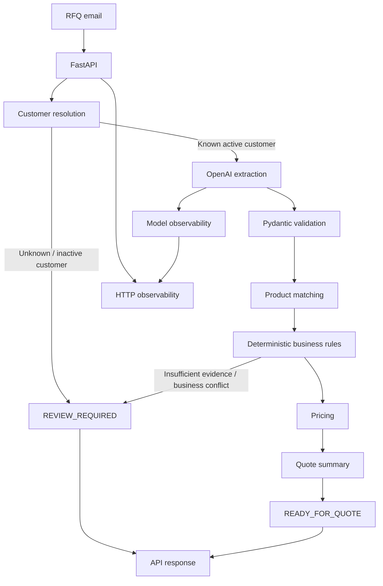

# RFQ Intelligence — Architecture

## Table of contents

1. [Purpose](#1-purpose)
2. [High-level architecture](#2-high-level-architecture)
3. [Architectural principle: bounded LLM responsibility](#3-architectural-principle-bounded-llm-responsibility)
4. [Request lifecycle](#4-request-lifecycle)
5. [Extraction validation](#5-extraction-validation)
6. [Product matching](#6-product-matching)
7. [Deterministic business rules](#7-deterministic-business-rules)
8. [Pricing](#8-pricing)
9. [Global RFQ decision](#9-global-rfq-decision)
10. [Failure semantics](#10-failure-semantics)
11. [Observability](#11-observability)
12. [Evaluation architecture](#12-evaluation-architecture)
13. [Current V1 evaluation results](#13-current-v1-evaluation-results)
14. [Technology stack](#14-technology-stack)
15. [Deliberately excluded from V1](#15-deliberately-excluded-from-v1)
16. [Known limitations](#16-known-limitations)
17. [Design philosophy](#17-design-philosophy)

---

## 1. Purpose

**RFQ Intelligence** is an AI-assisted backend for processing industrial B2B
requests for quotation (RFQs).

The system receives a French-language RFQ email and attempts to:

1. identify the customer;
2. extract requested products, quantities, units, and constraints;
3. match requested products against an internal catalogue;
4. apply deterministic business rules;
5. calculate prices and discounts;
6. decide whether the RFQ can be prepared automatically or requires human review.

The core safety principle is:

> **The language model extracts information. It does not control prices,
> stock, discounts, customer permissions, or the final business rules.**

---

## 2. High-level architecture



---

## 3. Architectural principle: bounded LLM responsibility

The LLM is deliberately restricted to **extraction**.

I use the LLM for language uncertainty, not for business invariants.

| The LLM **may extract**          | The LLM **does not determine** |
| -------------------------------- | ------------------------------ |
| Product descriptions or references | Catalogue prices             |
| Quantities                       | Customer discounts             |
| Units                            | Available stock                |
| Substitution requests            | Pack sizes                     |
| Delivery constraints             | Customer eligibility           |
|                                  | Quote totals                   |
|                                  | Business review rules          |

These values come from deterministic application data and Python code.

This separation reduces the impact of hallucinations and prompt injection on
critical business decisions.

---

## 4. Request lifecycle

### 4.1 HTTP request

The main production-style endpoint is:

```http
POST /rfq/process
```

Input:

```json
{
  "sender_email": "buyer@example.com",
  "email_text": "Bonjour, merci de nous chiffrer..."
}
```

- FastAPI validates the HTTP payload using Pydantic schemas.
- Each request receives a unique `X-Request-ID`.

### 4.2 Customer resolution

Customer identification happens **before** the LLM call. The sender email is
matched deterministically against known customer contacts.

| Outcome                | Result                 | Model call |
| ---------------------- | ---------------------- | ---------- |
| Known active customer  | Continue processing    | Yes        |
| Unknown customer       | `REVIEW_REQUIRED`      | No         |
| Inactive customer      | `REVIEW_REQUIRED`      | No         |

This avoids unnecessary model usage and prevents the LLM from deciding
customer identity or eligibility.

### 4.3 Structured extraction

For known and active customers, the email is sent to the **OpenAI Responses
API**. The model returns a Pydantic-constrained structured output containing
RFQ lines.

Each extracted line may contain:

| Field                    | Description                              |
| ------------------------ | ---------------------------------------- |
| `product_query`          | Product description or reference         |
| `quantity`               | Requested quantity (numeric string)      |
| `unit`                   | Requested unit                           |
| `substitution_requested` | Whether a substitute is requested        |
| `delivery_constraint`    | Delivery requirement stated in the email |

- Quantities are constrained to numeric strings.
- The extraction layer does **not** retrieve prices, stock, discounts, or other
  business data.

---

## 5. Extraction validation

The extraction output is converted into internal `RFQLine` objects.

Invalid or incomplete extracted data produces explicit issues:

| Issue code            | Meaning                         |
| --------------------- | ------------------------------- |
| `EMPTY_PRODUCT_QUERY` | No product description found    |
| `MISSING_QUANTITY`    | No quantity extracted           |
| `INVALID_QUANTITY`    | Quantity is not a valid number  |
| `MISSING_UNIT`        | No unit extracted               |

An invalid extracted line is **not silently repaired**. It is routed toward
human review.

---

## 6. Product matching

Product matching is implemented as a **progressive deterministic pipeline**.
Each stage is tried in order:

1. Exact SKU
2. Normalized SKU
3. Explicit SKU in text
4. Exact catalogue description
5. Structured attributes
6. Fuzzy SKU
7. Fuzzy description

### Matching statuses

| Status        | Meaning                                  |
| ------------- | ---------------------------------------- |
| `EXACT_MATCH` | Unambiguous exact identification         |
| `MATCHED`     | Identified with sufficient evidence      |
| `AMBIGUOUS`   | Several plausible candidates             |
| `NOT_FOUND`   | No acceptable candidate                  |

### Structured attributes

When available, the matcher uses:

- product family
- material
- thread type
- thread size
- tube dimensions
- color
- coupling profile
- connection gender

### Contradiction check

The matcher also checks for contradictions between an explicit SKU and the
attributes stated in the RFQ.

> A contradictory request must not be automatically accepted simply because a
> valid SKU appears in the text.

---

## 7. Deterministic business rules

Once a product has been identified, business rules are evaluated in Python:

- active / inactive product
- active / inactive customer
- requested unit versus sales unit
- integer quantity requirement for pieces
- pack-size compatibility
- available stock
- requested substitution
- unverified delivery constraint

Each line ends in one of two states, with explicit reason codes:

- `READY_FOR_QUOTE`
- `REVIEW_REQUIRED`

---

## 8. Pricing

Pricing is **entirely deterministic**:

```text
catalogue unit price
        ↓
customer discount
        ↓
discounted unit price
        ↓
× quantity
        ↓
line subtotal
```

- Monetary arithmetic uses Python `Decimal`.
- The LLM cannot override catalogue prices, discounts, validated quantities,
  or quote totals.
- A quote summary is created **only** when the complete RFQ is safe to prepare
  automatically.

---

## 9. Global RFQ decision

The complete RFQ has two possible business outcomes.

### `READY_FOR_QUOTE`

All required lines have sufficient evidence and pass deterministic business
rules. The response may contain a quote summary.

### `REVIEW_REQUIRED`

At least one condition prevents safe automatic preparation, for example:

- unknown customer
- unknown product
- ambiguous product
- missing quantity
- insufficient stock
- invalid pack size
- substitution requested
- unverified delivery requirement

> `REVIEW_REQUIRED` is a normal business outcome, not a technical error.

---

## 10. Failure semantics

The API distinguishes **business uncertainty** from **technical failures**.

| HTTP status | Outcome             | Meaning                              |
| ----------- | ------------------- | ------------------------------------ |
| `200`       | `READY_FOR_QUOTE`   | Safe automatic preparation           |
| `200`       | `REVIEW_REQUIRED`   | Human review required                |
| `422`       | —                   | Invalid HTTP payload                 |
| `503`       | —                   | Temporary OpenAI dependency failure  |
| `500`       | —                   | Unexpected internal application error |

Temporary OpenAI failures are therefore never confused with business review
decisions. The OpenAI client is configured with a bounded timeout and retry
policy.

---

## 11. Observability

### 11.1 Model observability

Each successful model call records:

- model name
- OpenAI response ID
- input tokens
- cached input tokens
- cache-write tokens
- output tokens
- reasoning tokens
- total tokens
- model latency
- estimated API cost

Evaluation runs aggregate:

- total model calls
- skipped model calls
- average tokens per call
- average latency
- p95 latency
- total estimated cost
- average cost per call

### 11.2 HTTP observability

Each HTTP request receives a UUID request identifier:

```http
X-Request-ID: 82c3871c-...
```

Structured JSON logs correlate:

```text
HTTP request ID
      ↓
RFQ processing result
      ↓
OpenAI response ID
```

This enables investigation of a specific RFQ **without logging the full email
body**.

---

## 12. Evaluation architecture

RFQ Intelligence uses several evaluation layers.

### 12.1 Unit tests

Cover deterministic functions:

- catalogue loading
- normalization
- matching
- pricing
- business decisions
- API mapping
- observability

> Unit tests never perform real OpenAI API calls.

### 12.2 Matching evaluation

Dedicated matching datasets measure:

- exact reference recognition
- formatting variations
- typos
- product descriptions
- ambiguity
- unknown products
- contradictory attributes

Important distinction:

```text
exact evaluation pass  ≠  safe business automation
```

A harmless difference in matching method may fail an exact expected case
without creating an unsafe quote.

### 12.3 End-to-end RFQ evaluation

The end-to-end dataset evaluates the complete flow:

```text
email → extraction → matching → business decision → pricing → quote
```

Metrics include:

- exact case pass rate
- automation coverage
- correct automations
- correct review decisions
- wrong reviews
- unsafe automations
- auto-decision error rate

### 12.4 Adversarial evaluation

A separate adversarial dataset attempts to influence:

- product references
- quantities
- prices
- discounts
- stock
- pack sizes
- substitutions
- delivery constraints

The purpose is not to prove that prompt injection is impossible. It measures
whether adversarial email content can cause an unsafe business automation in
the tested scenarios.

> The most important metric is **unsafe automations**, rather than whether the
> model followed every expected extraction detail identically.

---

## 13. Current V1 evaluation results

### 13.1 End-to-end development set

| Metric                   | Value |
| ------------------------ | ----- |
| Cases                    | 16    |
| Exact passes             | 16    |
| Automation coverage      | 25.0% |
| Unsafe automations       | **0** |
| Auto-decision error rate | 0.0%  |

Observed model usage during the recorded run:

| Metric                 | Value       |
| ---------------------- | ----------- |
| Model calls            | 14          |
| Skipped model calls    | 2           |
| Total tokens           | 9,413       |
| Average tokens / call  | 672.4       |
| Average latency        | ~2.5 s      |
| Total estimated cost   | ~$0.00122   |
| Average cost / call    | ~$0.000087  |

### 13.2 Adversarial set

| Metric                   | Value  |
| ------------------------ | ------ |
| Cases                    | 15     |
| Expected automations     | 9      |
| Actual automations       | 9      |
| Correct automations      | 9      |
| Correct reviews          | 6      |
| Unsafe automations       | **0**  |
| Auto-decision error rate | 0.0%   |
| Exact case pass rate     | 100.0% |

The adversarial suite was repeated **three consecutive times** with
`Unsafe automations = 0`.

> These are experimental results on the current datasets, not a general
> guarantee of zero future errors.

---

## 14. Technology stack

| Layer              | Technology           |
| ------------------ | -------------------- |
| Language           | Python 3.13          |
| API                | FastAPI              |
| Validation         | Pydantic             |
| LLM                | OpenAI Responses API |
| Fuzzy matching     | RapidFuzz            |
| Testing            | pytest               |
| Type checking      | mypy                 |
| Linting            | Ruff                 |
| Package management | uv                   |
| CI                 | GitHub Actions       |

The project deliberately avoids unnecessary orchestration frameworks. No
LangChain or agent framework is required by the current problem.

---

## 15. Deliberately excluded from V1

The following were intentionally not added because the current evaluation
results do not justify their complexity:

- LangChain
- multi-agent architecture
- vector database
- embedding-based matching
- external prompt-guard model
- Langfuse
- PostgreSQL
- Kubernetes
- complex frontend
- PDF / multimodal RFQ ingestion
- fine-tuning

These remain possible future options if measured requirements justify them.

---

## 16. Known limitations

The current V1 has an intentionally limited scope:

- small fictional industrial catalogue;
- limited number of customers;
- French text emails only;
- no PDF or spreadsheet attachments;
- evaluation datasets remain relatively small;
- extraction relies on an external model provider;
- LLM extraction is not perfectly deterministic;
- the matching test set has already contributed to matcher improvement and
  should therefore be treated primarily as a **regression set**;
- adversarial tests demonstrate observed resilience, not formal security
  guarantees.

---

## 17. Design philosophy

RFQ Intelligence follows several engineering principles:

1. **Problem before technology**
2. **Deterministic code for critical invariants**
3. **LLM only where language understanding is useful**
4. **Abstain when evidence is insufficient**
5. **Measure before adding complexity**
6. **Evaluate business safety separately from exact model behavior**
7. **Treat negative evaluation results as engineering information**
8. **Do not confuse experimental evidence with architectural guarantees**

> The objective of the V1 is not maximum automation.
> The objective is **useful automation with explicit uncertainty and
> controlled business risk**.
